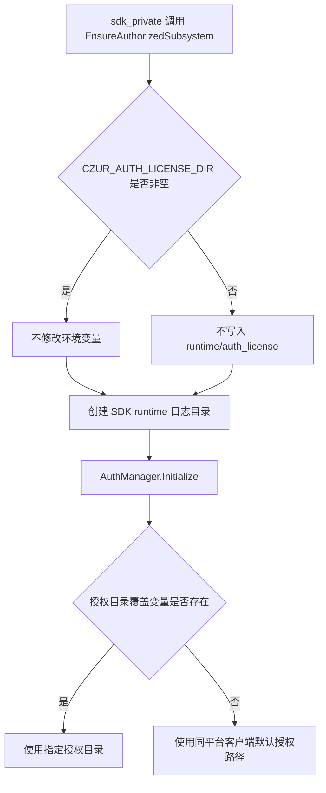

# SDK Private 与客户端共用本地授权文件设计

## 背景

`sdk_private` 的 `EnsureAuthorizedSubsystem()` 当前在 `CZUR_AUTH_LICENSE_DIR` 未设置时，自动将该进程的底层 `AuthManager` 授权文件目录设置为：

```text
<CZUR_SDK_RUNTIME_DIR>/auth_license
```

这使 `sdk_private` 与同一用户运行的客户端默认读取不同的隐藏授权文件。客户端已经完成的本地授权无法被独立 SDK 进程读取；SDK 的 Host 激活也不会自然反映到客户端。

## 目标

在 Windows 和 Linux 上统一以下规则：

1. 未显式设置 `CZUR_AUTH_LICENSE_DIR` 时，`sdk_private` 与同平台客户端使用 `AuthManager` 的平台默认授权文件路径。
2. 显式设置 `CZUR_AUTH_LICENSE_DIR` 时，保留其最高优先级；调用进程使用指定目录中的主授权文件和三个备份候选。
3. `CZUR_SDK_RUNTIME_DIR` 继续只控制 SDK runtime 数据，不再间接改变底层授权文件位置。

## 非目标

- 不改变 `AuthManager` 的 machine code、授权码解析、授权文件格式或主/备份恢复逻辑。
- 不修改 Windows 或 Linux 客户端的默认授权文件路径。
- 不迁移、复制、删除或合并历史 `<runtime>/auth_license` 中的文件。
- 不改变 `offline_entitlements.json` 的位置、结构或配额策略。
- 不改变显式设置 `CZUR_AUTH_LICENSE_DIR` 的自动化测试、诊断和隔离使用方式。

## 当前与目标行为

| 场景 | 当前 `sdk_private` | 目标 `sdk_private` |
|---|---|---|
| Windows，未设置 `CZUR_AUTH_LICENSE_DIR` | `<runtime>/auth_license` | Windows 客户端默认授权路径 |
| Linux，未设置 `CZUR_AUTH_LICENSE_DIR` | `<runtime>/auth_license` | Linux 客户端默认授权路径 |
| 任意平台，显式设置变量 | 指定目录 | 保持指定目录 |
| 改变 `CZUR_SDK_RUNTIME_DIR` | 改变 SDK runtime 与隐藏授权文件位置 | 仅改变 SDK runtime 数据位置 |

## 设计

### 路径决策

`AuthManager::Initialize()` 已经是唯一的授权文件路径决策点：

```text
CZUR_AUTH_LICENSE_DIR 非空
  -> 使用该目录下的 backup1、backup2、backup3 和主授权文件

CZUR_AUTH_LICENSE_DIR 为空
  -> 使用当前平台客户端默认授权文件路径
```

因此 `sdk_private` 不应重新实现客户端默认路径，也不应为未设置变量的情况写入派生目录。

### `EnsureAuthorizedSubsystem()` 改动

从 `EnsureAuthorizedSubsystem()` 中删除以下自动重定向职责：

```text
CZUR_AUTH_LICENSE_DIR 为空
  -> 设置为 <runtime>/auth_license
```

保留：

- 进程内互斥与一次性初始化；
- SDK runtime 日志目录创建；
- 调用 `AuthManager::Initialize()`；
- `AuthManager` 对外部显式 `CZUR_AUTH_LICENSE_DIR` 的既有处理。

不增加新参数、新环境变量或额外路径配置。

### 数据边界

```text
SDK runtime 目录
  - offline_entitlements.json
  - sdk_private 日志

AuthManager 授权目录
  - 客户端与 sdk_private 共用的隐藏授权文件
  - 仅在显式 CZUR_AUTH_LICENSE_DIR 时改为指定目录
```

`offline_entitlements.json` 仍保存 SDK 的本地配额和 Host 激活摘要；它不是客户端隐藏授权文件的替代品。清除客户端隐藏授权文件与清除 SDK runtime 摘要仍是两个独立操作。

## 调用流程



## 错误处理与兼容性

- SDK runtime 日志目录无法创建时，保持当前初始化失败语义。
- `AuthManager::Initialize()` 失败时，继续向调用方返回 `AuthManager::GetLastError()`。
- 不创建或访问旧 `<runtime>/auth_license`，避免 SDK 擅自处理用户已有隔离授权数据。
- 同一进程内 `AuthManager` 为单例：必须在它第一次初始化之前由调用方设置 `CZUR_AUTH_LICENSE_DIR`，运行中再变更变量不要求切换授权目录。

## 验收与测试

1. Windows：客户端默认路径已有有效本地授权；独立 `sdk_private` 不设置变量时读取同一授权状态。
2. Linux：客户端默认路径已有有效本地授权；独立 `sdk_private` 不设置变量时读取同一授权状态。
3. Windows/Linux：SDK 成功 Host 激活后，客户端从默认路径读取相同底层授权状态。
4. Windows/Linux：显式设置 `CZUR_AUTH_LICENSE_DIR` 后，SDK 使用指定隔离目录，不读写默认客户端授权文件。
5. Windows/Linux：仅设置 `CZUR_SDK_RUNTIME_DIR` 时，`offline_entitlements.json` 和 SDK 日志切换目录，但授权文件仍使用客户端默认路径。
6. 静态回归检查应证明 `EnsureAuthorizedSubsystem()` 不调用 `_putenv_s` 或 `setenv` 写入 `CZUR_AUTH_LICENSE_DIR`。

## 实施范围

生产代码预计仅修改：

```text
src/sdk_open/providers/private/auth/private_sdk_auth_service.cpp
```

新增或调整 SDK 私有授权相关测试，不修改客户端授权路径配置和 `AuthManager::Initialize()` 的显式覆盖优先级。
